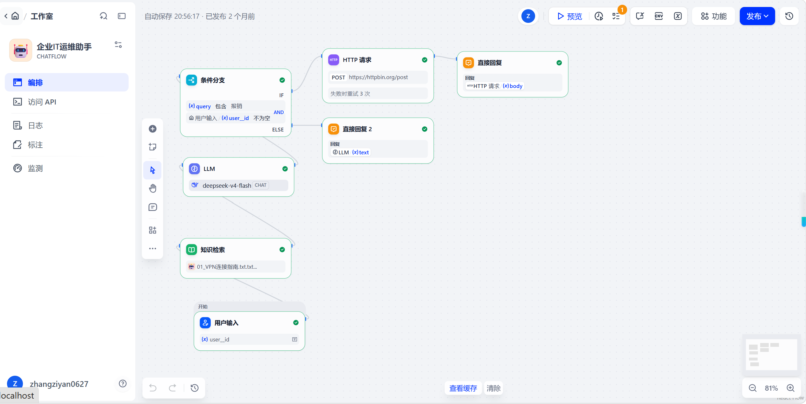

# 企业级 IT 运维智能助手 (Enterprise IT Ops Assistant)

这是一个基于 **Dify** 搭建的企业级 IT 运维综合助手。该 Agent 结合了 **RAG 知识库检索** 与 **外部工具调用 (HTTP API)**，实现了从用户意图识别、安全权限校验到业务闭环的自动化处理。

## 💡 核心架构与业务逻辑 (Core Features)

1. **意图识别与安全路由 (Intent Routing & Security)**
   通过前置的“条件分支”节点，精准识别用户意图并进行权限校验。当用户提出“报销”诉求时，系统会严格检查传入的 `user_id` 是否为空。只有 **意图命中 AND 权限校验通过** 时，才会触发后续的自动化业务流程；否则会自动降级到 LLM 进行安全兜底提示。
2. **RAG 知识库增强 (Knowledge Retrieval)**
   接入了企业内部 IT 知识库（如《VPN连接指南》等）。当用户咨询常规 IT 问题时，系统会优先从知识库检索，并利用严格约束的 Prompt 要求大模型“忠于原文，防跨文档污染”，大幅降低大模型的幻觉。
3. **外部 API 自动化集成与容错 (API Integration)**
   针对报销等业务，使用“HTTP 请求”节点打通外部业务系统。系统会将自然语言输入结构化为标准 JSON Payload（提取 `user_id`、`amount`、`action`），并发送 POST 请求。
   - 配置了 `Content-Type: application/json` 符合 RESTful 规范。
   - 配置了 **失败重试机制（重试 3 次）**，保障企业环境下的接口高可用性。
4. **智能兜底与分流 (Fallback Mechanism)**
   对于未能命中特定业务逻辑的通用问题，最终交由 LLM 节点进行兜底回复，保障用户体验。

## 🖼️ 工作流架构 (Workflow Structure)

*工作流逻辑：用户输入 -> 知识检索 -> 条件分支 (判断是否为“报销”意图 AND `user_id` 是否有效) -> 走 HTTP 请求触发外部系统 / 走 LLM 兜底回答。*

## 🚀 快速开始 (Quick Start)

###导入 DSL 文件 (本地/私有化部署)
1. 下载本仓库中的 `it-ops-assistant.yml` 文件。
2. 登录您的 Dify 账号。
3. 在“工作室”选择 **“导入 DSL 文件”**，上传该文件。
4. **⚠️ 必做步骤**：
   - 在“设置 -> 模型供应商”中配置模型 API Key。
   - **重新关联您的知识库**（DSL 文件不包含原知识库的具体文本数据）。
   - 将 HTTP 请求节点中的测试 API (`httpbin.org`) 替换为您实际的业务系统 API，并根据需要配置鉴权 Header。

## 🛠️ 技术栈与节点 (Tech Stack)
- **平台**: Dify
- **底层模型**: deepseek-v4-flash
- **核心节点**: 用户输入、知识检索 (RAG)、条件分支 (复合条件 IF/ELSE)、HTTP 请求 (含重试机制)、LLM、直接回复。

## 📄 License
This project is licensed under the MIT License.
